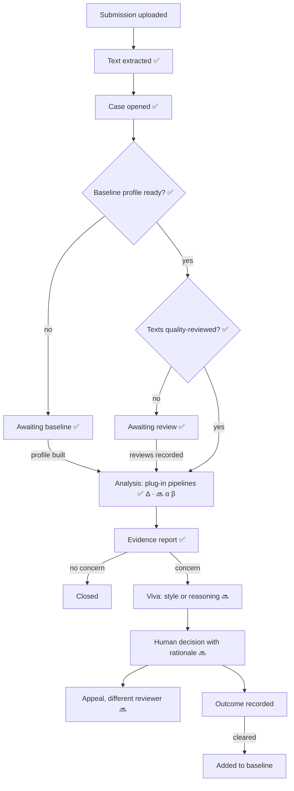
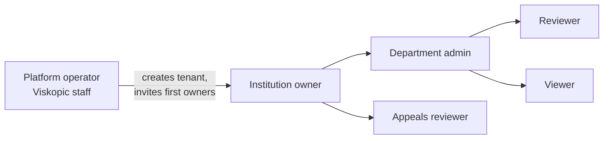
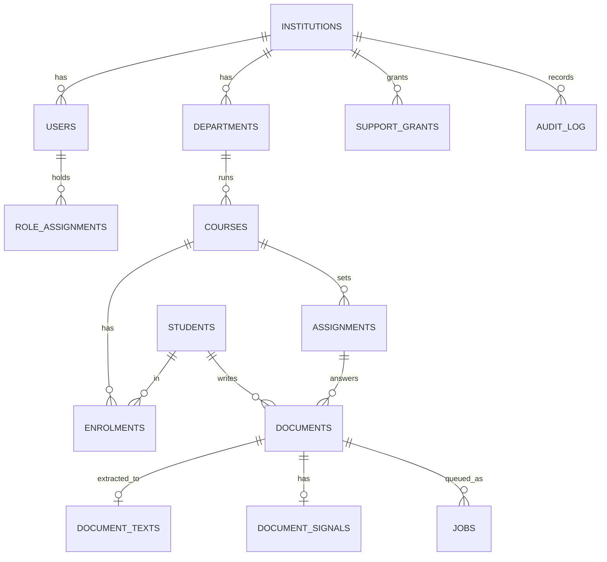
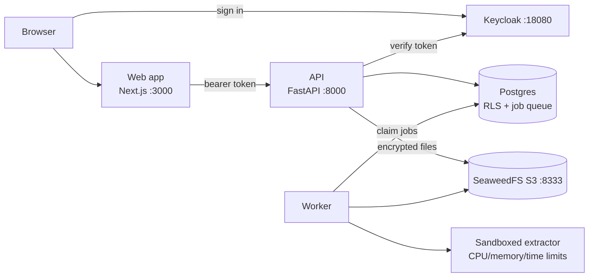

# Viskopic MVP design

Viskopic helps universities check whether a piece of student writing is consistent with that student's own past
work, and supports a fair human review when it isn't. This document is the agreed design for the MVP. The code
for the first milestone (foundations and intake) lives in [`app/`](../app/).

Status key: ✅ built · 🔜 next milestones

## 1. Principles

1. **Evidence, not bare scores.** Every result explains *why* (checkable observations), *where* (highlighted
   passages) and *how sure* (confidence from the size of the student's baseline). A reviewer should understand
   the case from the evidence alone.
2. **Scores route, they never convict.** The system suggests a next step. Only a human records an outcome.
3. **Compare students with themselves.** The baseline is the student's own writing, which also reduces bias
   against non-native writers compared with generic AI detectors.
4. **Viskopic cannot see university data.** Enforced by the database and encryption keys, not just policy.
5. **Everything is reproducible and audited.**

## 2. Case lifecycle



### Business rules

| Rule | Detail | Status |
|---|---|---|
| Intake gate | Upload only when student, course and enrolment are all active | ✅ |
| File checks | PDF, DOCX or UTF-8 TXT up to 10 MiB; type from content not name; no macros; zip-bomb limits | ✅ |
| Integrity | SHA-256 of the original stored; re-verified before extraction | ✅ |
| Retries | Up to 3 attempts with backoff; unreadable files fail at once with a clear reason | ✅ |
| Baseline eligibility | Product rule: ≥3 completed baseline essays and ≥1,500 words (summary shown). The Δ V1.3 model currently needs more: ≥8 baseline documents of ≥1,650 usable words each, and ≥1,650 words per submission. A validated student configuration is research work for the model team | ✅ |
| Confidence | low / medium / high from baseline size and how much is supervised. Δ: 8–9 documents low, 10+ medium, 10+ with ≥2 supervised high; demonstration profiles always low | ✅ |
| Profile versions | A profile is an immutable, versioned, encrypted artifact built only from `baseline` documents; a new version is built when the eligible set changes; cases waiting for a baseline are re-analysed when it is ready | ✅ |
| Baseline protection | Submissions are never used in a profile; a submission joins the baseline only after its case is cleared | ✅ / 🔜 (clearing) |
| Quality review (Δ) | The model only scores when a reviewer has checked the submission and **every** baseline document: English prose, clean extraction. A review is stored server-side, bound to the SHA-256 of the exact extracted text, append-only (a new review supersedes). Non-English / mixed / failed extraction blocks scoring; a review of an older text is out of date and blocks too. `VISKOPIC_ALLOW_UNREVIEWED_CONSISTENCY` (local development only) scores unreviewed texts as a labelled "unreviewed demonstration" | ✅ |
| Reproducibility | Each analysis run stores the pipeline version (Δ: model 1.3 + vendored commit), the frozen threshold and the profile version; re-runs add rows, nothing is overwritten | ✅ (evaluator θ 🔜) |
| Frozen evidence | A decision stores a snapshot of the evidence the reviewer saw | 🔜 |
| Separation of duties | Whoever decided a case cannot hear its appeal | 🔜 |
| Removing a wrong upload | Institution owners only, with a reason. Deletes the original file, extracted text and file signals; the document row stays as a tombstone (who, when, why) and the audit log records it. A removed baseline document retires every profile version built from it (artifacts deleted), queues a new profile from what's left and re-analyses the student's cases; a removed submission's case is withdrawn. Earlier analysis runs are kept (numbers and template text only). Once decisions exist, a document with a recorded decision will not be removable | ✅ |

### Evidence model ✅

Each pipeline returns a score plus **evidence items**: category (style, semantic, regeneration, document),
a template-generated statement, the observed value against the student's baseline mean and spread, the character
ranges to highlight, and its contribution to the overall result. Statements come from templates, never free LLM
text, so they are accurate and repeatable.

Evidence items store numbers, template statements and character offsets only, never essay text. Spans are offsets
into our extracted text (the Δ model samples from its own normalised copy, so passages are located again; status
`exact` or `approximate`).

| Pipeline | Status | Evidence it produces |
|---|---|---|
| Δ Consistency (style) | ✅ real model: frozen V1.3 from `VISKOPIC_PROJECT` (`model/v1-3-mvp-handoff`, commit `d102392`), vendored unchanged in `app/backend/vendor/consistency_v13`, called through the model team's website adapter (`viskopic.website-consistency.v1`) | every scored result labelled **experimental**; overall centred score vs frozen threshold with the margin (not a probability or percentage, can be negative, tiny values shown as "near zero"); raw distance and distance ÷ typical baseline distance, shown separately as descriptive diagnostics; the 3 feature groups that differ most; up to 8 features ≥2 spreads from the student's mean in the same direction in ≥2 of the 3 sampled passages, each with observed value, baseline mean and spread, and the passages to highlight |
| Document signals | ✅ | hidden text (white, ≤2pt, hidden formatting, invisible PDF layers); recorded editing time under 1 minute per 100 words. Author names are never copied into statements |
| β Language (regeneration) | 🔜 not built | run recorded as *unavailable* |
| α Authenticity (semantic) | 🔜 research code only | run recorded as *unavailable* |

**States without a verdict.** The adapter returns `insufficient_evidence` (too few baseline documents or usable
words), `quality_review_required`, `unsupported_text` or `cannot_score` instead of a score. These are stored as
`not_eligible` runs with the state in `details.website_status` and no score, label or evidence: the system never
manufactures a zero. A case waiting only for reviews has status `awaiting_review`.

**Demonstration profiles** (local development only, `VISKOPIC_ALLOW_DEMO_PROFILES`): a reviewer can link a
student to one of the 35 research-author profiles shipped with the model, to try the report before a real
baseline exists. The report says plainly that the comparison is not with the student's writing.

## 3. Roles and delegated administration ✅



| Role | Scope | Can | Cannot |
|---|---|---|---|
| Platform operator | Platform | Create/suspend institutions, invite owners while fewer than two exist, see usage counts, see job health while a support grant is active | See any student, document, text or decision |
| Institution owner | Institution | Everything in the institution, audit log, support grants | — |
| Department admin | Department | Courses, staff roles and students in their department | Act outside their department, create owners |
| Reviewer | Course | Students, assignments, uploads and text quality reviews on the course | Manage people |
| Viewer | Course | Read-only | Change anything |
| Appeals reviewer | Institution | Read-only across courses (appeals 🔜) | — |

- Roles are `(user, role, scope)` assignments, so one person can hold different roles on different courses.
- You can only grant roles within your own scope.
- The last institution owner cannot be removed.
- People sign in with SSO; the invitation is matched to a **verified** email on first sign-in, then bound to the
  SSO subject.

## 4. Database ✅

PostgreSQL. Every tenant table has `institution_id` and a row-level security policy. See
[`app/backend/migrations/0001_foundations.sql`](../app/backend/migrations/0001_foundations.sql).



Milestones 4–5 added ([`0002_analysis.sql`](../app/backend/migrations/0002_analysis.sql), [`0003_document_removal.sql`](../app/backend/migrations/0003_document_removal.sql), [`0004_quality_reviews.sql`](../app/backend/migrations/0004_quality_reviews.sql)): `baseline_profiles`
(versioned; encrypted artifact in object storage, SHA-256 in the row), `cases` (one per submission),
`analysis_runs` (append-only for the app role), `evidence_items` (append-only) and `document_quality_reviews`
(append-only; outcome + text digest + who/when, no text). Jobs gained the kinds
`build_profile` and `analyse_case`.

Next milestones add: `segments` (with pgvector embeddings), `evaluator_configs`, `evaluations`, `viva_sessions`,
`viva_questions`, `decisions`, `appeals`.

## 5. System (localhost) ✅



- One Python codebase runs as both API and worker.
- The job queue is a Postgres table claimed with `FOR UPDATE SKIP LOCKED`, with leases and numbered attempts so
  a stale worker can't overwrite a newer result.
- Files are parsed in a separate process with CPU, memory, file-handle and time limits.
- Pipelines (✅) plug into the worker behind one interface (`viskopic/analysis/base.py`):

```python
class Pipeline(Protocol):
    name: str
    version: str
    def run(self, ctx: AnalysisContext) -> PipelineResult: ...   # score, confidence, evidence items
```

- The Δ model is loaded once per worker process and verifies every asset and frozen-source hash at startup.
  Enrolled profiles are decrypted to a temporary file only to load them, after their recorded hash is checked.
  The model keeps loaded profiles in one in-process registry; nothing that lists profiles may expose it (only the
  built-in research profiles are ever listed).

## 6. Security and "Viskopic cannot see your data" ✅

| Layer | How |
|---|---|
| Tenant isolation | The API sets `app.institution_id` on each transaction; RLS policies hide every other institution's rows. The app's database role is not the table owner and has no `BYPASSRLS`. Tested at API and raw-SQL level. |
| Operator isolation | Operators never get a tenant context. Their only database access is a handful of `SECURITY DEFINER` functions that return metadata (names, counts) or invite owners. |
| Support access | Customer-granted, time-limited (max 7 days), revocable, audited; shows job status and errors only. |
| Encryption | Envelope encryption with a data key per institution. Student numbers, names, original files and extracted text are encrypted before storage. Locally the key-encryption key is in `.env`; in production it lives in the **university's own KMS**, so they can revoke it. |
| Pseudonymisation | Students appear as `S-XXXXXXXX`. Exact-match lookup by student number uses a keyed hash. |
| Audit | Append-only (no UPDATE/DELETE grant, plus a trigger). Records role changes, uploads, text views and operator actions, visible to the institution owner. |
| Uploads | Content-type sniffing, size and zip-bomb limits, macro rejection, sandboxed parsing, checksums. |
| Prompt injection | Hidden text is excluded from the extracted text and reported as a signal. |
| Web | Bearer tokens via OIDC Authorization Code + PKCE; CORS restricted; security headers; ports bound to localhost. |

Planned before a pilot: real university SSO (Keycloak brokering or direct OIDC/SAML), KMS key provider, TLS,
ClamAV, rate limiting, retention/deletion jobs including derived data, backups, DPIA, penetration test, and the
option to deploy into the university's own cloud account.

## 7. Milestones

1. ✅ Foundations: compose stack, migrations, SSO, tenancy + RLS, delegated roles, audit log
2. ✅ Academic records: departments, courses, students, enrolments, assignments
3. ✅ Intake: upload, validation, encrypted storage, queue, sandboxed extraction, retries, document signals
4. ✅ Cases and baselines: case creation on submission, versioned encrypted baseline profiles, eligibility
5. ✅ Pipeline contract, document-signal pipeline, **real Δ (V1.3)** through the model team's website contract with
   quality reviews, α/β placeholders, evidence report UI
6. 🔜 Evaluator with versioned θ, viva questions linked to evidence, decisions, appeals
7. 🔜 Real α (semantic) and β (regeneration) pipelines; a validated Δ student configuration (fewer, shorter
   baseline essays) from the model team
